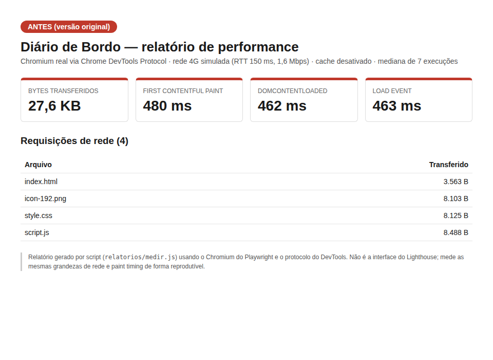
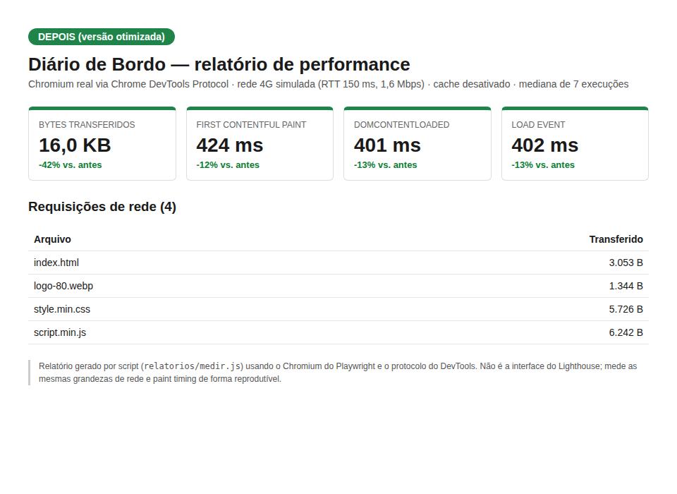

# Diário de Bordo — otimização de performance

PWA para registrar atividades diárias (título, descrição e data), com funcionamento offline, instalação na tela inicial e persistência via `localStorage`.

Este repositório é o resultado de um exercício de **diagnóstico e otimização de performance web**: medir, encontrar gargalos, otimizar e comprovar a melhoria com números.

## Estrutura

```
├── index.html, style.min.css, script.min.js   # produção (minificados)
├── manifest.json, service-worker.js
├── icons/                                     # ícones PWA + logo-80.webp/png (cabeçalho)
├── src/                                       # código-fonte legível (index.html, style.css, script.js)
├── versao-original/                           # projeto ANTES das otimizações (baseline)
└── relatorios/                                # relatórios antes/depois (PNG e PDF) + script de medição
```

`src/` guarda o código legível; a raiz contém os arquivos de produção minificados.

## Como foi medido

Cada versão foi servida localmente e carregada no **Chromium real** via Chrome DevTools Protocol (Playwright), com rede 4G simulada (RTT 150 ms, 1,6 Mbps), cache desativado e **mediana de 7 execuções**. Script reproduzível em [`relatorios/medir.js`](relatorios/medir.js).

> **Transparência:** os relatórios em `relatorios/` foram gerados por esse script (bytes transferidos, First Contentful Paint, DOMContentLoaded, Load). Não são a interface do Lighthouse. Como o projeto já é muito leve, o Lighthouse tende a mostrar nota alta nas duas versões; o ganho aparece melhor nos bytes e tempos abaixo.

## Gargalos identificados

1. **Imagem sobredimensionada:** o logo do cabeçalho é exibido a 40×40 px, mas carregava `icon-192.png` (192×192, ~7,9 KB).
2. **Formato de imagem:** apenas PNG, sem formato moderno (WebP).
3. **CSS e JS sem minificação:** comentários, indentação e espaços extras.
4. **HTML sem minificação.**
5. **`<script>` sem `defer`.**

### Técnicas que não se aplicavam (e por quê)

- **`loading="lazy"`:** a única `` é o logo, acima da dobra. Lazy loading nela atrasaria um elemento visível de imediato (prejudicial). Usei em seu lugar dimensionamento correto e `fetchpriority="high"`.
- **Trocar bibliotecas pesadas:** o projeto não usa bibliotecas externas.
- **Código morto:** verifiquei as classes CSS contra HTML/JS e não há seletores órfãos.

## Melhorias aplicadas

1. Logo recriado em 80×80 (2× para retina), servido em **WebP** com fallback PNG via `<picture>`.
2. PNGs restantes recomprimidos sem perda.
3. **Minificação** de CSS, JS e HTML.
4. `defer` no script e `fetchpriority="high"` no logo.
5. Service worker atualizado (`CACHE_VERSION` v2, lista de arquivos de produção) para não servir arquivos antigos do cache.

## Comparativo antes × depois

| Métrica | Antes | Depois | Melhoria |
|---|---:|---:|---:|
| Bytes transferidos | 28.279 B | 16.365 B | **-42%** |
| First Contentful Paint | 480 ms | 424 ms | **-12%** |
| DOMContentLoaded | 462 ms | 401 ms | **-13%** |
| Load event | 463 ms | 402 ms | **-13%** |
| Requisições | 4 | 4 | — |

| Arquivo | Antes | Depois | Redução |
|---|---:|---:|---:|
| Logo do cabeçalho (`icon-192.png` → `logo-80.webp`) | 8.103 B | 1.344 B | 83% |
| CSS | 8.125 B | 5.726 B | 30% |
| JS | 8.488 B | 6.242 B | 26% |
| HTML | 3.563 B | 3.053 B | 14% |

(Tamanhos transferidos incluem cabeçalhos HTTP.)

**Maior impacto:** a troca do logo (−83%), seguida da minificação de CSS e JS. Relatórios completos: [`relatorio-antes`](relatorios/relatorio-antes.png) · [`relatorio-depois`](relatorios/relatorio-depois.png) (também em PDF).




## Rodando localmente

Service workers exigem `http://localhost` (não funcionam com `file://`):

```bash
python3 -m http.server 8080   # acesse http://localhost:8080
```

Para repetir a medição: sirva `versao-original/` na porta 8091 e a raiz na 8092, instale `playwright` e rode `node relatorios/medir.js`.

## Funcionalidades

- Registro de entradas persistidas em `localStorage`, funcionando offline via service worker.
- Botão **Instalar aplicativo** (evento `beforeinstallprompt`, Chrome/Edge). No iOS: Compartilhar → Adicionar à Tela de Início.
